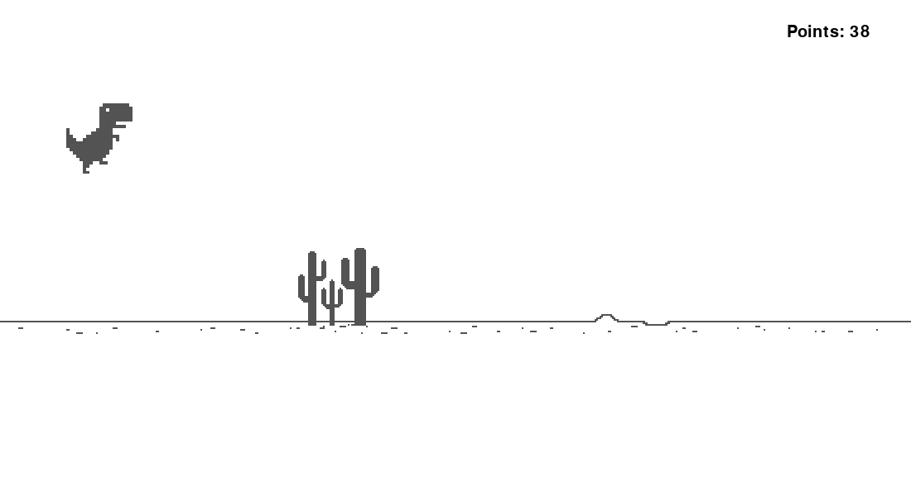

# 🦖 恐龙小游戏（Dino Run Game）

用 **Python + Pygame** 复刻 Chrome 浏览器断网时那只小恐龙的跑酷游戏。从零实现角色三态动画、三类障碍物、无缝滚动背景、实时计分与动态加速，以及基于独立碰撞盒的碰撞判定。



---

## 📖 项目简介

浏览器断网时，Chrome 会放出一只小恐龙让你按空格打发时间。本项目用 Pygame 把这套玩法完整复刻了一遍：

- 恐龙会**跑、会跳、会蹲**，三套动画来自独立的图片帧；
- 路上随机出现**小仙人掌、大仙人掌、翼龙**三种障碍；
- 背景**无缝滚动**，天上飘着白云；
- 右上角实时显示分数，**每 100 分自动加速**；
- 撞到障碍即游戏结束，按任意键重新开始。

代码只有单文件 `main.py`（约 340 行），结构清晰、注释完整，适合作为 Pygame 入门与面向对象练习的参考实现。

---

## ✨ 功能特性

| 功能 | 实现方式 | 代码位置 |
| --- | --- | --- |
| 角色奔跑动画 | 两张奔跑图按 `step_index // 5` 交替切换 | `Dinosaur.run()` |
| 角色跳跃 | 速度递减模拟重力，落回初始高度才结束跳跃 | `Dinosaur.jump()` |
| 角色下蹲 | 切换下蹲图并把 Y 坐标下移 30px | `Dinosaur.duck()` |
| 三类障碍物 | 继承 `Obstacle` 基类，各自设置不同的 `rect.y` 与碰撞盒 | `SmallCactus` / `LargeCactus` / `BirdCactus` |
| 无缝滚动背景 | 同一张 2400px 长图横向拼接滚动，出屏后归零 | `background()` |
| 装饰云朵 | 出屏后随机重置 X/Y 重新飘入 | `Cloud.update()` |
| 实时计分 | 每帧 +1 分 | `score()` |
| 动态加速 | 每满 100 分，`game_speed` +1 | `score()` |
| 碰撞判定 | 独立内缩碰撞盒，避免"看着没碰到却死了" | `Dinosaur._update_collision_rect()` |
| 死亡与重开 | 撞到障碍延迟 2 秒后进入菜单循环 | `main()` → `menu()` |

---

## 🛠 环境要求

| 项目 | 版本 | 说明 |
| --- | --- | --- |
| Python | 3.13+ | 开发环境为 3.14.8 |
| pygame | 2.5.8 | 开发环境使用 pygame-ce 2.5.8（接口与 pygame 兼容） |
| 操作系统 | Windows / macOS / Linux | 无平台相关代码 |

---

## 🚀 快速开始

```bash
# 1. 克隆仓库
git clone https://github.com/Abeautiful-crypto/Dino-Run-Game.git
cd Dino-Run-Game

# 2. 创建并激活虚拟环境
python -m venv .venv
.venv\Scripts\activate          # Windows
# source .venv/bin/activate     # macOS / Linux

# 3. 安装依赖
pip install pygame

# 4. 运行游戏
python main.py
```

> **资源路径说明**：`main.py` 用 `os.path.dirname(os.path.abspath(__file__))` 把资源根目录锚定到脚本自身所在目录，
> 所以无论从哪个工作目录启动，图片都能正常加载（前提是 `main.py` 与 `Cactus/`、`Dino/`、`Other/` 三个文件夹保持同级）。

---

## 🎮 玩法操作

| 操作 | 按键 | 说明 |
| --- | --- | --- |
| 开始游戏 | 任意键 | 进入主循环 |
| 跳跃 | `↑` | 空中不能二次起跳 |
| 下蹲 | `↓` | 跳跃过程中不能下蹲 |
| 退出 | 关闭窗口 | 触发 `pygame.QUIT` |

**得分规则**：每帧 +1 分（30 FPS 下约 30 分/秒），每满 100 分游戏速度 +1，越跑越快。

---

## 📁 目录结构

```
Dino-Run-Game/
├── main.py                              # 游戏主程序（唯一代码文件）
├── screenshot.png                       # 游戏截图
├── Cactus/                              # 障碍物素材
│   ├── 1_Cactus_Chrome_Dino.png         # 小仙人掌  50 × 105
│   ├── 3_Cactus_Chrome_Dino.png         # 大仙人掌 104 × 105
│   └── Chrome_Pterodactyl.png           # 翼龙     194 × 127
├── Dino/                                # 恐龙素材
│   ├── pao/                             # 跑（pao = 跑）
│   │   ├── Chrome_T-Rex_Left_Run.png    # 奔跑帧 1  88 × 85
│   │   └── Chrome_T-Rex_Right_Run.png   # 奔跑帧 2  88 × 85
│   └── dun/                             # 蹲（dun = 蹲）
│       ├── Chrome_T-Rex_Left_Duck.png   # 下蹲帧 1 118 × 54
│       └── Chrome_T-Rex_Right_Duck.png  # 下蹲帧 2 118 × 55
└── Other/                               # 场景素材
    ├── Chromium_T-Rex-cloud.png         # 白云      92 × 28
    └── Chromium_T-Rex-horizon.png       # 地面长图 2400 × 24
```

> 本地开发时素材放在 `Assects/` 子目录下（`Assects/main.py` + `Assects/Dino/...`），与仓库根目录的扁平结构等价——
> 只要 `main.py` 与三个素材文件夹同级即可正常运行。

---

## 🧩 代码结构

| 名称 | 类型 | 职责 | 关键实现点 |
| --- | --- | --- | --- |
| `load_images()` | 函数 | 一次性加载全部图片并返回 8 个列表 | `os.path.join(ASSETS, ...)` 拼路径，避免硬编码 |
| `Dinosaur` | 类 | 玩家角色 | 用三个布尔量 `dino_run / dino_jump / dino_duck` 表示状态；`step_index` 累计到 10 归零 |
| `Cloud` | 类 | 装饰云朵 | 出屏后随机重置 X（+2500~3000）与 Y（50~100） |
| `Obstacle` | 类 | 障碍物基类 | 持有 `image / type / rect / collision_rect`，提供统一 `update()` / `draw()` |
| `SmallCactus` | 类 | 小仙人掌 | `rect.y = 325`，随机选一张图 |
| `LargeCactus` | 类 | 大仙人掌 | `rect.y = 300`，体积更大 |
| `BirdCactus` | 类 | 翼龙 | `rect.y = 200`（空中），需要下蹲或跳过 |
| `score()` | 内嵌函数 | 计分与加速 | 每帧 +1，`points % 100 == 0` 时 `game_speed += 1` |
| `background()` | 内嵌函数 | 背景滚动 | 双图拼接，`x_pos_bg <= -image_width` 时归零，实现无缝 |
| `main()` | 函数 | 游戏主循环 | 事件处理 → 绘制 → 生成障碍 → 移动 → 碰撞检测 → 计分 → `tick(30)` |
| `menu()` | 函数 | 开始 / 结束界面 | 接收 `death_count` 决定显示文案 |

**关键参数一览**

| 参数 | 数值 | 作用 / 换算 |
| --- | --- | --- |
| `SCREEN_WIDTH` × `SCREEN_HEIGHT` | 1100 × 600 | 窗口尺寸 |
| 帧率 | 30 FPS | `clock.tick(30)` |
| `Dinosaur.X_POS` / `Y_POS` | 80 / 310 | 恐龙站立位置 |
| `Dinosaur.Y_POS_DUCK` | 340 | 下蹲时的 Y 坐标 |
| `JUMP_VEL` | 8.5 | 起跳初速度 |
| 重力加速度 | 0.8 | 每帧从 `jump_vel` 中递减 |
| 跳跃表现 | 峰值约 195 px，滞空约 22 帧（≈0.7 秒） | 由 `v₀ = 8.5`、`g = 0.8` 推导 |
| `game_speed` 初值 | 20 px / 帧 | 障碍物与背景每帧左移的距离 |
| 加速规则 | 每 100 分 +1 | 30 FPS 下约每 3.3 秒提速一次 |
| 障碍生成概率 | `random.randint(0, 3)` | 0 / 1 / 2 分别对应三类障碍，3 表示本轮不生成 |

---

## 🎯 碰撞判定：为什么不用图片矩形？

PNG 素材四周自带透明留白，如果直接拿图片的 `get_rect()` 做碰撞检测，会出现"明明还有一段距离却已经判定死亡"的挫败感。

因此项目为**恐龙**和**每一个障碍物**都额外维护了一个内缩的 `collision_rect`，物理判定只用它，绘制仍用原图矩形：

| 对象 | 相对图片矩形的内缩 | 代码位置 |
| --- | --- | --- |
| 恐龙（站立 / 奔跑） | 左右各 15 px、上 10 px、下 10 px | `Dinosaur.__init__()` |
| 恐龙（下蹲） | 左右各 20 px、上 15 px、下 15 px | `Dinosaur._update_collision_rect()` |
| 障碍物基类 | 左右各 10 px、上 5 px、下 5 px | `Obstacle.__init__()` |
| 小仙人掌 | 左右各 8 px | `SmallCactus.__init__()` |
| 大仙人掌 | 左右各 10 px | `LargeCactus.__init__()` |
| 翼龙 | 左右各 12 px、上 10 px、下 15 px | `BirdCactus.__init__()` |

判定语句只有一行：

```python
if player.collision_rect.colliderect(obstacle.collision_rect):
    ...
```

---

## ❓ 常见问题

| 现象 | 原因 | 解决 |
| --- | --- | --- |
| `ModuleNotFoundError: No module named 'pygame'` | 未安装依赖或未激活虚拟环境 | `pip install pygame`，并确认已激活 `.venv` |
| `FileNotFoundError: .../Dino/pao/...` | `main.py` 与素材文件夹不在同一级 | 保持 `main.py`、`Cactus/`、`Dino/`、`Other/` 同级 |
| 窗口一片空白，按键才开始游戏 | 首次进入时没有渲染开始提示（见下方问题 3） | 属已知问题，按任意键即可开始 |
| 菜单界面 CPU 占用偏高 | `menu()` 循环内没有限帧 | 属已知问题，见下方问题 2 |
| 想显示中文却变成方块 | 用的是 `pygame.font.get_default_font()`，不含中文字形 | 改用 `pygame.font.Font("字体文件.ttf", 20)` |

---

## 🐞 已知问题与优化清单

**代码结构**

1. `menu()` 与 `main()` 相互递归调用：每次死亡都会多叠一层循环嵌套，多次死亡后会出现多个事件循环同时存在，表现为速度异常、按键错乱。建议改为**状态机 + 单层主循环**（`MENU` / `PLAYING` / `GAME_OVER`）。
2. `menu()` 的 `while` 循环里没有 `clock.tick()`，会占满一个 CPU 核心空转。
3. 首次进入时（`death_count == 0`）只创建了 `text` 对象，既没有 `blit()` 也没有 `display.update()`，所以 "Press any key to start" 实际不会显示，启动画面是空白窗口。
4. 得分显示时机不对：`menu()` 里先执行 `points = 0` 再调用 `main()`，导致 "YOU Score" 只有在下一局结束后才渲染，而且显示的是新一局的分。建议进入 game over 前把本局得分存到局部变量。
5. `death_count` 失效：`main()` 里的 `death_count = 0` 是局部变量，每次重新开始都会被重置，所以 "Press any key to Restart" 分支很难走到。
6. 遍历 `obstacles` 时直接 `remove()` 元素：会跳过相邻元素，可能漏删障碍物。建议倒序遍历或先收集再统一删除。

**视觉细节**

7. 翼龙只有 1 帧图片，`BirdCactus.draw()` 里的 `index // 5 % len(self.image)` 恒为 0，实际没有振翅动画，需要补充第二帧素材。
8. `load_images()` 中跳跃动画直接复用了奔跑图（`jumping` 引用的是 `Run` 图），跳跃时视觉上是"站着平移"，建议单独准备跳跃帧。

**工程规范**

9. 仓库里提交了 `__pycache__/*.pyc` 编译缓存，建议添加 `.gitignore` 并从版本库中移除：
   ```gitignore
   __pycache__/
   *.pyc
   .venv/
   .idea/
   ```

**功能增强（Roadmap）**

- [ ] 重构为状态机主循环，消除递归嵌套
- [ ] 最高分持久化（`json` 存本地文件）
- [ ] 音效（跳跃、得分、碰撞）
- [ ] 昼夜交替模式（还原 Chrome 同款 700 分后变色）

---

## 📝 素材说明

游戏中的恐龙、仙人掌、翼龙、云朵与地面素材均来自 **Chrome 浏览器离线小恐龙**，版权归原作者（Google）所有，本项目仅用于学习与交流，不作商业用途。

---

## 👤 作者

- GitHub：[@Abeautiful-crypto](https://github.com/Abeautiful-crypto)
- 提交者：chenchunbo

如果这个项目对你有帮助，欢迎点个 ⭐ Star。
